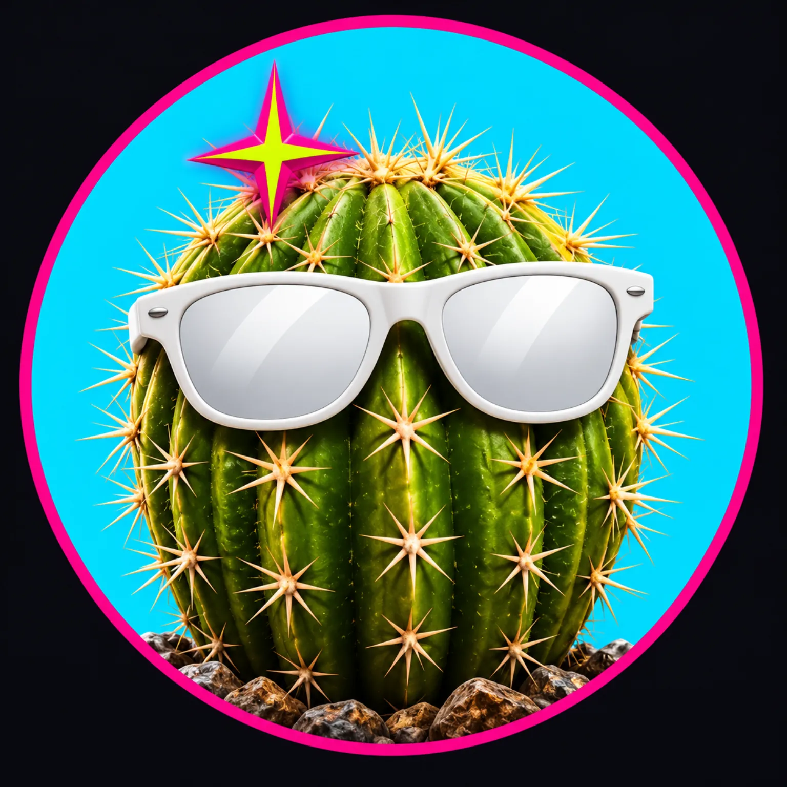

# Spike — 2027 Character Bible

Approved direction established November 2026. Production guidance for Vegas Sidekick marketing, social media and character artwork. Read alongside [BRAND.md](BRAND.md). This document does not authorize changes to existing logos or website layouts.

## 1. Character premise

Spike is a cactus who happens to be an exceptionally useful Vegas entertainment insider. He is not a comedian trying to get laughs. His existence and circumstances are the joke.

**The Insider With a Weird Side.**
**Character slogan:** You'll never want to do Vegas without Spike.
**Parent brand slogan:** Vegas has a show for that.

| Personality | Creative weighting | How it appears |
|---|---:|---|
| Deadpan Insider | 70% | Calm, competent, unfazed, practical |
| Mysterious Celebrity | 20% | Familiar to strangers; unexplained connections and intriguing settings |
| Lovable Weirdo | 10% | Eccentric habits and unexpected situations, never desperate for attention |

These are creative emphasis guidelines, not a quota for each scene.

## 2. Visual source of truth

The realistic social avatar above is the primary appearance reference for new character artwork. Use it as an actual image reference when the generator supports one; do not rely on text alone.

| Feature | Production standard |
|---|---|
| Silhouette | Compact, rounded, vertically ribbed barrel/hedgehog cactus; not a tall saguaro, human body or flat paddle cactus |
| Surface | Natural deep and medium greens, realistic plant texture, pale golden radial spine clusters |
| Eyewear | Oversized white wayfarer-style frames; opaque white lenses, no visible eyes or recognizable reflected scenery. Subtle neutral material shading is acceptable in realistic images; use flat white in graphic icons |
| Signature ornament | One offset four-point Vegas-inspired starburst near the upper left as viewed from the front; magenta with lime center in the primary realistic reference |
| Face | No mouth, eyebrows, nose, teeth or expressive human facial features |
| Arms | Optional short rounded cactus offshoots for full-body compositions; never long human arms, hands or fingers. The canonical close-up avatar has no visible arms |
| Proportions | Compact, slightly taller than wide; large eyewear across the upper-middle body; keep silhouette and eyewear consistent between shots |
| Color | Natural cactus green first; selective lime highlights, not an entirely fluorescent plant |
| Scale | Can vary with the fictional setting; preserve body proportions rather than implying a fixed real-world height |

Do not invent exact spine counts or physical dimensions. Match the supplied reference closely. The starburst is a signature ornament, not a second character, halo or rotating accessory. Keep it in the same position across shots.

## 3. Approved asset variants

| Variant | Reference | Use |
|---|---|---|
| Realistic avatar | [spike-profile-avatar.webp](images/brand/spike-profile-avatar.webp) | Master character reference, social avatar, recommendations |
| Social cover | [vegas-sidekick-social-cover.webp](images/brand/vegas-sidekick-social-cover.webp) | Wide brand artwork and general sharing |
| Horizontal badge | [transparent pill](images/brand/vegas-sidekick-pill-logo-transparent.svg) | Website navigation and promotional lockups |
| Circular badge | [transparent circle](images/brand/vegas-sidekick-circle-logo-transparent.svg) | Branded badge placements |
| Micro icon | [favicon.svg](images/brand/favicons/favicon.svg) | Browser and small-scale interface identity |

Existing approved logos are fixed artwork, not anatomy references. The pill uses simplified graphics and dark lenses; the circle retains a flower and short arms. These are permitted legacy/brand-lockup exceptions, not permission to introduce those features into new realistic campaigns. The simplified favicon omits small details for legibility. Do not regenerate approved logos, stretch them or redraw their typography.

## 4. Performance and personality

- Spike is unflappable. Play a ridiculous scene with complete sincerity.
- He never explains why he is a cactus, begs for attention or laughs at his own joke.
- His mystery is gradual: leave connections and backstory unexplained; do not establish a birthplace, age, family or supernatural origin as canon without approval.
- Express attitude through framing, stillness, props, pacing and the reactions of other characters, not invented facial anatomy.
- In live-action-style marketing, prefer Spike as a silent presence by default. Narration, a host, captions or an off-screen voice can carry the message. Written recommendations retain the established Spike voice. Spoken character dialogue is a campaign-specific creative choice, not a mandatory rule.
- Never manufacture real endorsements, first-hand attendance, ticket availability or evidence of expertise. Fictional scenes are advertising, not reportage.

## 5. Creative world

Modern surrealism first, selective retro Vegas second. Spike can appear in a contemporary hotel, a retro TV commercial, an ordinary kitchen or an impossible setting. Do not force every execution into the 1990s.

Four campaign families already discussed: unexpected locations, fictional commercials, ordinary life of an extraordinary cactus, and entertainment-insider recommendations. Treat the proposed 30/25/20/25 split as a planning starting point, not a locked production requirement.

One clear visual joke per execution. Bold colors, believable lighting, restrained effects, readable brand connection. Avoid childish cartoon behavior, generic casino imagery, excessive neon glow, meme clutter and explaining the joke.

Spike Television is an optional fictional setting, not a real broadcaster. Fictional ads must not mislead viewers about real products, offers or availability.

## 6. Voice

Direct, warm, dry and decisive. The factual website voice and Kris's authored recommendations remain distinct from fictional mascot performance.

- Lead with the useful fact; make an actual recommendation when recommending a show.
- No fake urgency, invented prices, invented experiences or unsupported superlatives.
- No generic tourism hype, forced cactus puns or exclamation marks in body copy.
- Humor can attract attention; it must never obscure material ticket information.

## 7. Reusable image prompt

Attach the canonical avatar as reference whenever possible.

> Create photorealistic commercial advertising featuring Spike, the Vegas Sidekick mascot. Match the supplied reference: a compact rounded green barrel cactus with natural vertical ribs, pale golden radial spines, oversized white wayfarer frames with opaque white lenses, and one magenta four-point starburst with lime center offset to the upper left. No eyes, mouth, eyebrows, nose or human limbs. If a wider composition requires arms, use only short rounded cactus offshoots. Preserve the same silhouette and eyewear. Spike remains completely calm and deadpan in an absurd but realistically photographed situation. Bold saturated color, clean composition, believable lighting, one central visual idea. Modern surrealism with optional selective retro Vegas influence. Scene: [specific setting and visual joke]. Framing: [platform and crop]. Leave space for approved brand assets if required; do not invent or redraw the wordmark.

For video, add:
> Maintain exact character appearance and proportions in every frame. No lip-sync, facial morphing, changing sunglasses, migrating starburst, extra limbs or changing spine pattern. Prefer restrained movement and environmental action. Specify shot length, camera movement, action and any host/narrator dialogue separately. Do not add unrequested speech.

## 8. Pre-release character QA

- [ ] Match the canonical avatar for silhouette, greens, eyewear and ornament.
- [ ] No new facial anatomy or human limbs; no unexplained visual continuity errors.
- [ ] One clear concept, recognizable brand association and crop-safe composition.
- [ ] Real entertainment information independently verified; fictional scenarios not presented as fact.
- [ ] Use approved logo files, not generated text approximations.
- [ ] Check thumbnail readability and video continuity where applicable.

## 9. Open production decisions

The full-body reference sheet, side/rear views and exact animation rig are not yet approved. The short-arm guidance and silence-by-default are recommended production defaults, not claims that those features appear in every existing asset. If a new campaign needs a permanent change to the character, obtain explicit approval and update this document and BRAND.md together.
